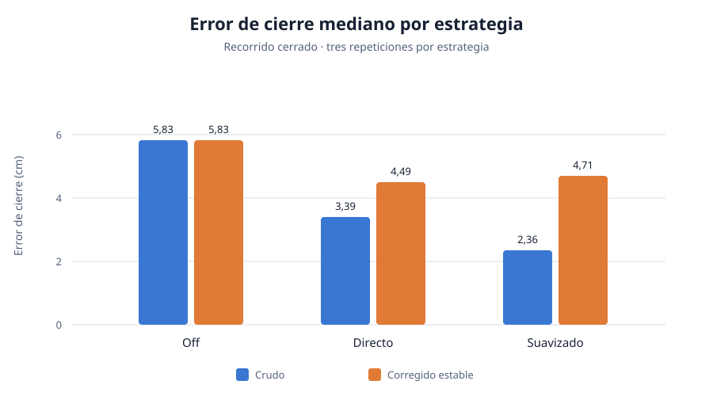
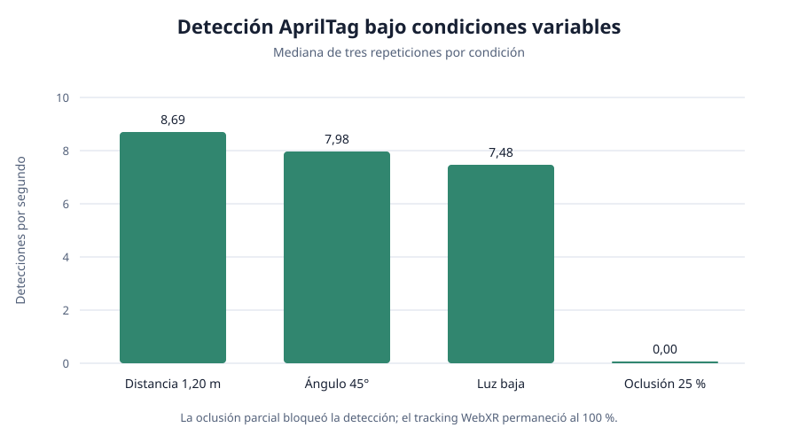

# Informe final — VIO web con AprilTags y Foxglove

Fecha de cierre experimental: **2026-11-23**. Dispositivo: **POCO X7 Pro** con
Chrome Android y ARCore.

## 1. Objetivo

El proyecto implementa una aplicación web que obtiene la pose visual-inercial
del celular mediante WebXR, captura la cámara con Raw Camera Access, detecta
AprilTags 36h11, corrige la deriva contra un mapa conocido y publica pose,
transformaciones, marcadores y métricas en Foxglove Studio.

## 2. Arquitectura validada

1. Chrome Android inicia `immersive-ar` con `local-floor`.
2. La pose WebXR se transforma al marco `odom` y se envía por WebSocket seguro.
3. La imagen se reduce a gris y OpenCV.js detecta AprilTags en un Web Worker.
4. PnP calcula `T_cam_marker` y su error de reproyección.
5. El corrector estima `T_world_odom` en modo directo o suavizado.
6. El servidor registra JSONL y publica cinco tópicos en Foxglove.

## 3. Entorno experimental

| Elemento            | Configuración                                        |
| ------------------- | ---------------------------------------------------- |
| Celular             | POCO X7 Pro                                          |
| Cliente             | Chrome Android, WebXR/ARCore                         |
| Red                 | WiFi LAN, HTTPS con CA local de `mkcert`             |
| Marcador            | AprilTag 36h11 ID 0, lado negro de 16 cm             |
| Cámara procesada    | Gris 288×640 a aproximadamente 10 Hz                 |
| Intrínsecos         | XRView: `[487,73, 487,57, 144,00, 320,00]`           |
| Mapa controlado     | Origen debajo del marcador; centro a 1,20 m del piso |
| Registro            | Servidor `--record`, JSONL y `tools/analyze_run.ts`  |
| Corrección evaluada | `off`, `direct` y `smooth`                           |

## 4. Resultados por fase

### 4.1. WebXR, pose y cámara

- HTTPS, `immersive-ar`, `local-floor` y `camera-access`: operativos.
- Tracking: 100 % en las corridas físicas dirigidas.
- Tasa de pose: aproximadamente 26–29 Hz con detección activa.
- Signos verificados: avance `+world.x`, izquierda `+world.y`, altura
  `+world.z` y yaw derecho alrededor de `-world.z`.
- Deriva estacionaria inicial: 1,7 mm en aproximadamente 30 s.

### 4.2. AprilTag y PnP

- 882 detecciones iniciales del ID 0.
- Error de reproyección inicial: media 0,326 px; máximo 2,092 px.
- Con marcador de 16 cm a 60 cm, PnP estimó 56,26 cm: error −6,23 %.
- Los ejes de `T_cam_marker` respondieron con los signos esperados.

### 4.3. Corrección absoluta

En el mapa físico controlado, la posición esperada del celular era
`[0,000, 0,600, 1,200] m`. La mediana corregida fue
`[0,023, 0,627, 1,154] m`:

| Eje / magnitud | Error   |
| -------------- | ------- |
| Lateral        | 2,3 cm  |
| Profundidad    | 2,7 cm  |
| Altura         | −4,6 cm |
| Error 3D       | 5,8 cm  |

Se aceptaron 79 correcciones y la reproyección mediana fue 0,559 px.

### 4.4. Corrida real y deriva

La corrida cerrada de la Fase 8 duró 27,21 s y registró 724 poses a 26,57 Hz,
con tracking 100 % y marcador visible el 86,19 % del tiempo. El cierre crudo fue
26,96 cm. La pose relativa al marcador cambió aproximadamente 1,4 cm entre el
inicio y el final, por lo que la diferencia representa principalmente deriva de
la odometría y no un retorno físico incorrecto.

### 4.5. Comparación de estrategias

Se realizaron tres recorridos cerrados por estrategia. Para `direct` y `smooth`,
el cierre corregido estable se calculó después de la primera relocalización; el
valor directo del analizador mezcla dos marcos durante esa transición y no es
comparable.

| Estrategia | Cierres crudos (cm) | Cierres corregidos estables (cm) | Mediana corregida |
| ---------- | ------------------- | -------------------------------- | ----------------- |
| Off        | 26,96 · 2,53 · 5,83 | 26,96 · 2,53 · 5,83              | 5,83 cm           |
| Directo    | 13,56 · 3,39 · 2,15 | 7,87 · 2,83 · 4,49               | 4,49 cm           |
| Suavizado  | 5,07 · 0,79 · 2,36  | 5,88 · 1,99 · 4,71               | 4,71 cm           |

En este recorrido corto y con tracking estable, las correcciones no redujeron
el error en todas las repeticiones. Directo mejoró claramente la primera
corrida, pero PnP y la variación de colocación pueden dominar cuando la deriva
cruda ya es pequeña. Suavizado redujo la magnitud de cada ajuste, aunque no
garantizó un cierre menor.

### 4.6. Condiciones variables

| Condición                 | Resultado de tres repeticiones                             |
| ------------------------- | ---------------------------------------------------------- |
| Distancia 1,20 m          | PnP 1,09–1,11 m; tracking 100 %; reproyección 0,27–0,28 px |
| Ángulo oblicuo ≈45°       | PnP 0,82–0,83 m; tracking 100 %; reproyección 0,19–0,23 px |
| Iluminación ambiente baja | PnP 0,61 m; tracking 100 %; reproyección 0,25–0,26 px      |
| Oclusión parcial ≈25 %    | 0 detecciones y 0 correcciones; tracking WebXR 100 %       |

La pantalla mantuvo el marcador autoiluminado durante la prueba de luz baja;
este resultado no equivale a un marcador impreso en una sala oscura. La
oclusión parcial bloqueó la detección del patrón, pero la odometría WebXR siguió
operativa, por lo que el sistema degradó a VIO sin corrección.

## 5. Conclusiones

El prototipo web completó el flujo WebXR → cámara → AprilTag/PnP → corrección →
relay/Foxglove y registro. La pose absoluta alcanzó 5,8 cm de error 3D en el
montaje controlado y PnP quedó dentro de ±10 % a distancia conocida. Directo y
Suavizado se comportaron según su diseño: el primero aplica ajustes completos y
el segundo reduce cada salto. En recorridos cortos, ninguna estrategia fue
superior en todas las repeticiones, lo que confirma la necesidad de informar la
dispersión y no solo una corrida favorable.

## 6. Limitaciones

- Un solo modelo de celular y un único marcador mostrado en pantalla.
- Montaje controlado, no una sala completa con múltiples marcadores rígidos.
- La latencia calculada contiene un offset de reloj cliente/servidor de alrededor
  de un segundo y no representa latencia de red aislada.
- El cierre corregido debe medirse después de la primera relocalización.
- La iluminación baja no reproduce el comportamiento de un marcador impreso.
- La oclusión del 25 % impidió la detección en las tres repeticiones.

## 7. Evidencia y reproducción

- Evidencia estructurada:
  [`evidence/poco-x7-pro-physical-tests-2026-11-23.json`](evidence/poco-x7-pro-physical-tests-2026-11-23.json).
- Resumen por estrategia:
  [`evidence/phase9-strategy-summary.csv`](evidence/phase9-strategy-summary.csv).
- Resumen de condiciones:
  [`evidence/phase9-condition-summary.csv`](evidence/phase9-condition-summary.csv).
- Guía experimental: [`phase-9-physical-tests.md`](phase-9-physical-tests.md).
- Resultados técnicos ampliados: [`results.md`](results.md).

Los JSONL, manifiestos y CSV completos del analizador permanecen en
`data/runs/` y no se versionan, según las reglas del proyecto.
